# Superhero Intelligence System — Machine Learning Project Report

**Course / Assignment:** Machine Learning Project · Assignment 03  
**Research Question:** *Can six ability scores tell a hero from a villain?*  
**Group Members:** [Add 2–3 Group Member Names]  
**Submission Deadline:** 06 December 2026 at 11:59 PM  

---

## Executive Summary & Global Standards

This report implements the complete **Superhero Intelligence System** pipeline across Data Preparation, Classification (Task 1), Unsupervised Clustering (Task 2), and Neural Networks & Final 5-Model Ranking (Task 3) using the Hugging Face `jrtec/Superheroes` dataset (`data/train.csv` and `data/test.csv`, retaining all publishers).

- **Input Feature Lock:** Every model uses **strictly** the 6 numeric ability scores (`intelligence_score`, `strength_score`, `speed_score`, `durability_score`, `power_score`, `combat_score`). Forbidden columns (`overall_score`, `history_text`, `powers_text`, `superpowers`, `has_*` flags, `name`, `creator`, `gender`, `height`, `weight`, `colours`, etc.) are never passed as model inputs.
- **Reproducibility Lock:** `random_state=42` is passed to all supporting estimators, splitters, PCA, and K-Means calls, and `tf.keras.utils.set_random_seed(42)` is set prior to building/training each TensorFlow/Keras neural network.
- **Leakage Lock:** `train.csv` and `test.csv` are never merged; `.fit()` and `.fit_transform()` are never called on `test.csv` or validation splits; `test.csv` is opened only once at the end of Tasks 1 and 3 and never used in Task 2.

---

## Section 2: Data Preparation (10 Marks)

### Step 1 — Dataset Inspection & Zero/Blank Accounting (`T1`)

#### Table T1a: Dataset File Overview (`train.csv` & `test.csv`)

| File | Rows | Columns | Total Missing Cells (All 83 Cols) | Dtype Breakdown |
|---|---:|---:|---:|---|
| `data/train.csv` | 1,158 | 83 | 7,356 | `float64`: 50, `str`: 26, `int64`: 7 |
| `data/test.csv` | 290 | 83 | 2,072 | `float64`: 50, `str`: 26, `int64`: 7 |

#### Table T1b: Ability Score Columns — Blanks & Sentinel Zeros (`0` → `NaN`)

| Score Column | Train Dtype | Train Blanks | Train `0`s | Train Total `NaN` | Test Dtype | Test Blanks | Test `0`s | Test Total `NaN` |
|---|---|---:|---:|---:|---|---:|---:|---:|
| `intelligence_score` | `int64` | 0 | 85 | 85 | `int64` | 0 | 20 | 20 |
| `strength_score` | `int64` | 0 | 91 | 91 | `int64` | 0 | 22 | 22 |
| `speed_score` | `int64` | 0 | 86 | 86 | `int64` | 0 | 20 | 20 |
| `durability_score` | `int64` | 0 | 87 | 87 | `int64` | 0 | 20 | 20 |
| `power_score` | `int64` | 0 | 57 | 57 | `int64` | 0 | 14 | 14 |
| `combat_score` | `int64` | 0 | 85 | 85 | `int64` | 0 | 20 | 20 |

#### Table T1c: All 83 Columns — Names, Data Types & Missing Counts per File

| # | Column | Train Dtype | Train Missing | Test Dtype | Test Missing |
|---:|---|---|---:|---|---:|
| 0 | `name` | `str` | 0 | `str` | 0 |
| 1 | `real_name` | `str` | 113 | `str` | 35 |
| 2 | `full_name` | `str` | 384 | `str` | 110 |
| 3 | `overall_score` | `str` | 0 | `str` | 0 |
| 4 | `history_text` | `str` | 72 | `str` | 17 |
| 5 | `powers_text` | `str` | 291 | `str` | 75 |
| 6 | `intelligence_score` | `int64` | 0 | `int64` | 0 |
| 7 | `strength_score` | `int64` | 0 | `int64` | 0 |
| 8 | `speed_score` | `int64` | 0 | `int64` | 0 |
| 9 | `durability_score` | `int64` | 0 | `int64` | 0 |
| 10 | `power_score` | `int64` | 0 | `int64` | 0 |
| 11 | `combat_score` | `int64` | 0 | `int64` | 0 |
| 12 | `superpowers` | `str` | 0 | `str` | 0 |
| 13 | `alter_egos` | `str` | 0 | `str` | 0 |
| 14 | `aliases` | `str` | 0 | `str` | 0 |
| 15 | `place_of_birth` | `str` | 529 | `str` | 131 |
| 16 | `first_appearance` | `str` | 158 | `str` | 43 |
| 17 | `creator` | `str` | 106 | `str` | 31 |
| 18 | `alignment` | `str` | 66 | `str` | 14 |
| 19 | `occupation` | `str` | 351 | `str` | 83 |
| 20 | `base` | `str` | 466 | `str` | 112 |
| 21 | `teams` | `str` | 0 | `str` | 0 |
| 22 | `relatives` | `str` | 446 | `str` | 124 |
| 23 | `gender` | `str` | 111 | `str` | 32 |
| 24 | `type_race` | `str` | 322 | `str` | 83 |
| 25 | `height` | `str` | 0 | `str` | 0 |
| 26 | `weight` | `str` | 0 | `str` | 0 |
| 27 | `eye_color` | `str` | 206 | `str` | 56 |
| 28 | `hair_color` | `str` | 201 | `str` | 48 |
| 29 | `skin_color` | `str` | 1,018 | `str` | 257 |
| 30 | `img` | `str` | 66 | `str` | 21 |
| 31 | `has_electrokinesis` | `float64` | 49 | `float64` | 16 |
| 32 | `has_energy_constructs` | `float64` | 49 | `float64` | 16 |
| 33 | `has_mind_control_resistance` | `float64` | 49 | `float64` | 16 |
| 34 | `has_matter_manipulation` | `float64` | 49 | `float64` | 16 |
| 35 | `has_telepathy_resistance` | `float64` | 49 | `float64` | 16 |
| 36 | `has_mind_control` | `float64` | 49 | `float64` | 16 |
| 37 | `has_enhanced_hearing` | `float64` | 49 | `float64` | 16 |
| 38 | `has_dimensional_travel` | `float64` | 49 | `float64` | 16 |
| 39 | `has_element_control` | `float64` | 49 | `float64` | 16 |
| 40 | `has_size_changing` | `float64` | 49 | `float64` | 16 |
| 41 | `has_fire_resistance` | `float64` | 49 | `float64` | 16 |
| 42 | `has_fire_control` | `float64` | 49 | `float64` | 16 |
| 43 | `has_dexterity` | `float64` | 49 | `float64` | 16 |
| 44 | `has_reality_warping` | `float64` | 49 | `float64` | 16 |
| 45 | `has_illusions` | `float64` | 49 | `float64` | 16 |
| 46 | `has_energy_beams` | `float64` | 49 | `float64` | 16 |
| 47 | `has_peak_human_condition` | `float64` | 49 | `float64` | 16 |
| 48 | `has_shapeshifting` | `float64` | 49 | `float64` | 16 |
| 49 | `has_heat_resistance` | `float64` | 49 | `float64` | 16 |
| 50 | `has_jump` | `float64` | 49 | `float64` | 16 |
| 51 | `has_self-sustenance` | `float64` | 49 | `float64` | 16 |
| 52 | `has_energy_absorption` | `float64` | 49 | `float64` | 16 |
| 53 | `has_cold_resistance` | `float64` | 49 | `float64` | 16 |
| 54 | `has_magic` | `float64` | 49 | `float64` | 16 |
| 55 | `has_telekinesis` | `float64` | 49 | `float64` | 16 |
| 56 | `has_toxin_and_disease_resistance` | `float64` | 49 | `float64` | 16 |
| 57 | `has_telepathy` | `float64` | 49 | `float64` | 16 |
| 58 | `has_regeneration` | `float64` | 49 | `float64` | 16 |
| 59 | `has_immortality` | `float64` | 49 | `float64` | 16 |
| 60 | `has_teleportation` | `float64` | 49 | `float64` | 16 |
| 61 | `has_force_fields` | `float64` | 49 | `float64` | 16 |
| 62 | `has_energy_manipulation` | `float64` | 49 | `float64` | 16 |
| 63 | `has_endurance` | `float64` | 49 | `float64` | 16 |
| 64 | `has_longevity` | `float64` | 49 | `float64` | 16 |
| 65 | `has_weapon-based_powers` | `float64` | 49 | `float64` | 16 |
| 66 | `has_energy_blasts` | `float64` | 49 | `float64` | 16 |
| 67 | `has_enhanced_senses` | `float64` | 49 | `float64` | 16 |
| 68 | `has_invulnerability` | `float64` | 49 | `float64` | 16 |
| 69 | `has_stealth` | `float64` | 49 | `float64` | 16 |
| 70 | `has_marksmanship` | `float64` | 49 | `float64` | 16 |
| 71 | `has_flight` | `float64` | 49 | `float64` | 16 |
| 72 | `has_accelerated_healing` | `float64` | 49 | `float64` | 16 |
| 73 | `has_weapons_master` | `float64` | 49 | `float64` | 16 |
| 74 | `has_intelligence` | `float64` | 49 | `float64` | 16 |
| 75 | `has_reflexes` | `float64` | 49 | `float64` | 16 |
| 76 | `has_super_speed` | `float64` | 49 | `float64` | 16 |
| 77 | `has_durability` | `float64` | 49 | `float64` | 16 |
| 78 | `has_stamina` | `float64` | 49 | `float64` | 16 |
| 79 | `has_agility` | `float64` | 49 | `float64` | 16 |
| 80 | `has_super_strength` | `float64` | 49 | `float64` | 16 |
| 81 | `id` | `int64` | 0 | `int64` | 0 |
| 82 | `prompt` | `str` | 0 | `str` | 0 |

*Caption (Table T1):* Both `train.csv` (1,158 × 83; 7,356 raw missing cells) and `test.csv` (290 × 83; 2,072 raw missing cells) share the same 83 columns (all listed in T1c with their data types and per-file missing counts) and store all 6 ability scores as `int64` with zero raw blanks, yet contain 491 and 116 hidden `0` entries respectively (ranging from 57 `power_score` zeros to 91 `strength_score` zeros in `train.csv`). Converting those sentinel zeros to `NaN` ensures unknown abilities are imputed from training medians rather than falsely treated as zero capability.

---

### Steps 2–5 — Cleaning Pipeline, Clean Set A & Clean Set B (`T2`)

Steps 1–4 were applied identically to `train.csv` and `test.csv`:
1. **Duplicates:** 0 within-file duplicates in `train.csv`, 0 within-file duplicates in `test.csv`, and 0 cross-file name overlaps (distinct version names such as `"Captain X"` vs. `"Captain X (Film)"` preserved).
2. **Mark Missing & Remove Weak Rows:** Converting blanks and `0`s to `NaN` and dropping characters with `≥ 3` missing scores removed **86** weak rows from `train.csv` and **20** weak rows from `test.csv`.
3. **Clean Set A (Task 2 Clustering):** All **1,072** cleaned `train.csv` characters (`Good`, `Bad`, `Neutral`, and blank alignments); `alignment` held aside until Step 8; `test.csv` not used.
4. **Clean Set B (Tasks 1 & 3 Supervised):** Filtered to `Good → 0 (Hero)` and `Bad → 1 (Villain)`. Removed alignments after Step 4:
   - `train.csv`: **93** `Neutral` + **63** blank = **156** rows removed → **916** rows retained.
   - `test.csv`: **31** `Neutral` + **14** blank = **45** rows removed → **225** rows retained.
5. **Median Imputation:** Remaining `NaN`s (1–2 missing scores) are filled inside scikit-learn `Pipeline`s using training-set medians only (`SimpleImputer(strategy="median")`).

#### Table T2: Rows After Each Cleaning Step

| Step | `train.csv` | `test.csv` |
|---|---:|---:|
| Loaded | 1,158 | 290 |
| After step 2 (duplicates) | 1,158 | 290 |
| After step 4 (weak rows) | 1,072 | 270 |
| Clean Set A | 1,072 | not used |
| Clean Set B | 916 | 225 |

*Caption (Table T2):* Table T2 tracks sample counts across each cleaning stage, leaving 1,072 characters in Clean Set A (`train.csv` only) and 916 / 225 characters in Clean Set B (`train.csv` / `test.csv`) after removing 86 + 20 weak rows and dropping 156 (`93` Neutral, `63` blank) training and 45 (`31` Neutral, `14` blank) test non-binary alignment rows.

---

## Section 3: Task 1 — Classification (25 Marks)

### Class Distribution on Clean Set B (`T3`, `G1`)

#### Table T3: Class Counts and Percentages (Clean Set B)

| Dataset | Total | Good (Hero) Count | Good (Hero) % | Bad (Villain) Count | Bad (Villain) % |
|---|---:|---:|---:|---:|---:|
| `train.csv` | 916 | 588 | 64.19% | 328 | 35.81% |
| `test.csv` | 225 | 137 | 60.89% | 88 | 39.11% |

*Caption (Table T3):* Table T3 shows moderate class imbalance in both splits of Clean Set B, with Heroes comprising 64.19% of `train.csv` (588 vs. 328) and 60.89% of `test.csv` (137 vs. 88). Consequently, Macro-F1 rather than raw accuracy is required to evaluate Hero and Villain detection fairly.

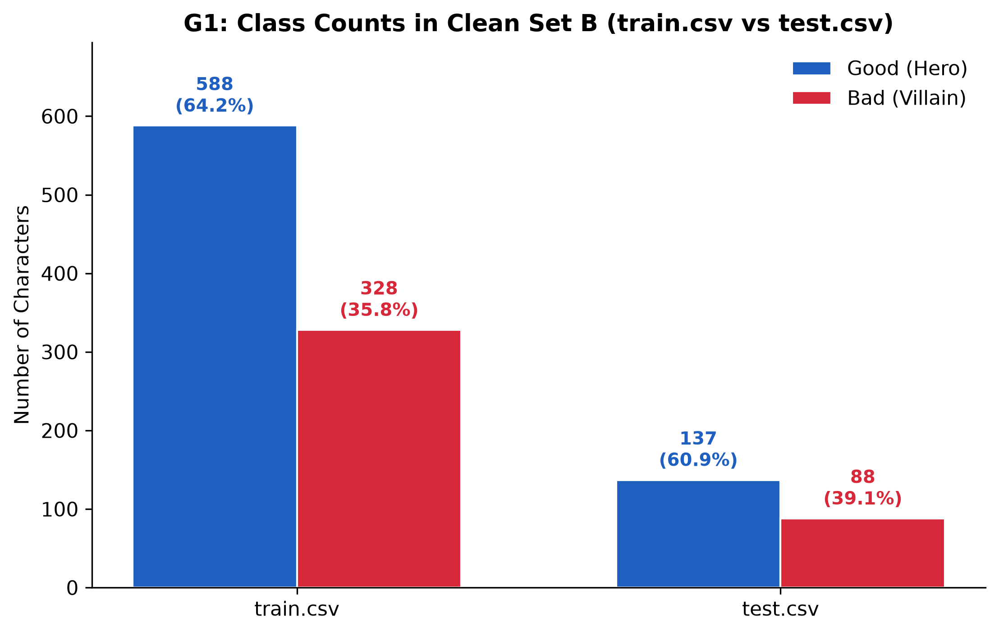

*Caption (Graph G1):* G1 compares Good (Hero) and Bad (Villain) counts side by side across `train.csv` (588 vs. 328) and `test.csv` (137 vs. 88). Because Heroes form ~61%–64% of each split, a majority-class baseline reaches 60.9% test accuracy while achieving 0.000 Villain recall.

---

### 5-Fold Stratified GridSearchCV & Final Test Results (`T4`, `T5`, `G2–G4`)

#### Table T4: Best Hyperparameters & 5-Fold CV Macro-F1 (`train.csv` Only)

| Model | Grid Combinations | Best Hyperparameters | Best 5-Fold CV Macro-F1 |
|---|---:|---|---:|
| Decision Tree | 15 | `{'clf__max_depth': 5, 'clf__min_samples_leaf': 10}` | 0.5405 |
| KNN | 12 | `{'clf__n_neighbors': 9, 'clf__weights': 'uniform'}` | 0.5145 |

*Caption (Table T4):* Table T4 lists the winning 5-fold stratified `GridSearchCV` configurations on `train.csv` alone: Decision Tree selected `max_depth=5, min_samples_leaf=10` (0.5405 CV Macro-F1) and KNN selected `n_neighbors=9, weights='uniform'` (0.5145 CV Macro-F1). Both CV Macro-F1 values remain modest (~0.51–0.54), indicating substantial overlap between Heroes and Villains in ability-score space.

#### Table T5: Task 1 Results (`Train Macro-F1` & `test.csv` Metrics)

| Model | Train Macro-F1 | Accuracy | Precision Hero | Recall Hero | F1 Hero | Precision Villain | Recall Villain | F1 Villain | Macro-F1 |
|---|---:|---:|---:|---:|---:|---:|---:|---:|---:|
| Baseline | 0.391 | 0.609 | 0.609 | 1.000 | 0.757 | 0.000 | 0.000 | 0.000 | 0.378 |
| Decision Tree | 0.563 | 0.560 | 0.594 | 0.876 | 0.708 | 0.261 | 0.068 | 0.108 | 0.408 |
| KNN | 0.601 | 0.596 | 0.624 | 0.847 | 0.718 | 0.462 | 0.205 | 0.283 | 0.501 |

*Caption (Table T5):* Table T5 evaluates the refitted Task 1 models on `test.csv` once, showing KNN leads decisively with 0.501 Test Macro-F1 and 0.205 Villain recall compared with Decision Tree (0.408 Macro-F1, 0.068 Villain recall) and Baseline (0.378 Macro-F1). By the `Train − Test Macro-F1 > 0.10` rule both models overfit: Decision Tree drops by 0.155 (0.563 → 0.408) and KNN by 0.1003 (0.601 → 0.501), so KNN only just crosses the threshold.

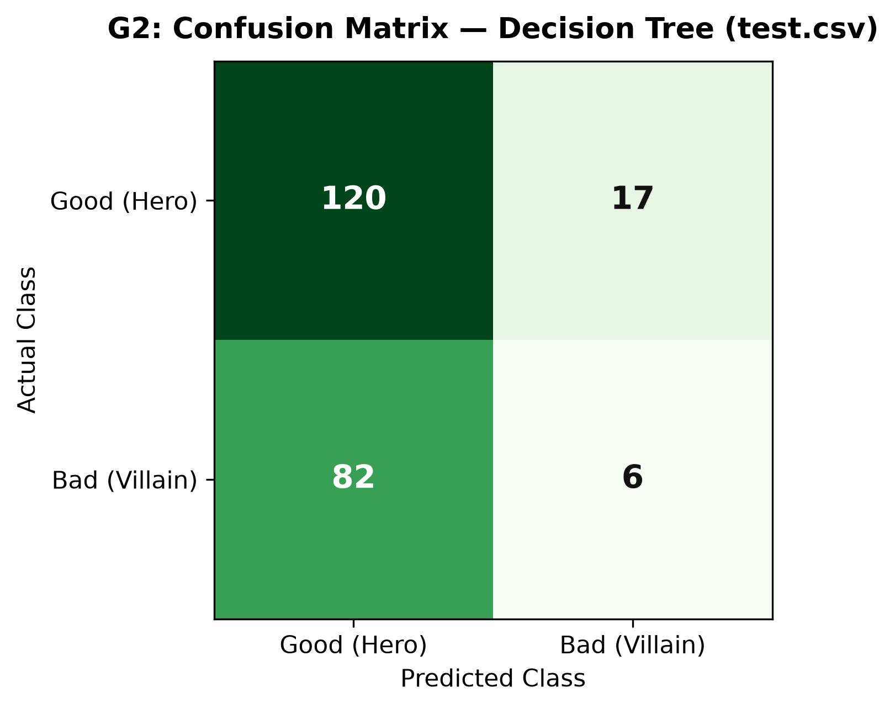

*Caption (Graph G2):* G2 shows the Decision Tree confusion matrix on `test.csv` (120 True Heroes, 17 False Villains, 82 missed Villains, 6 True Villains). Misclassifying 82 of 88 actual Villains (93.2%) as Heroes explains its weak Villain F1 (0.108).

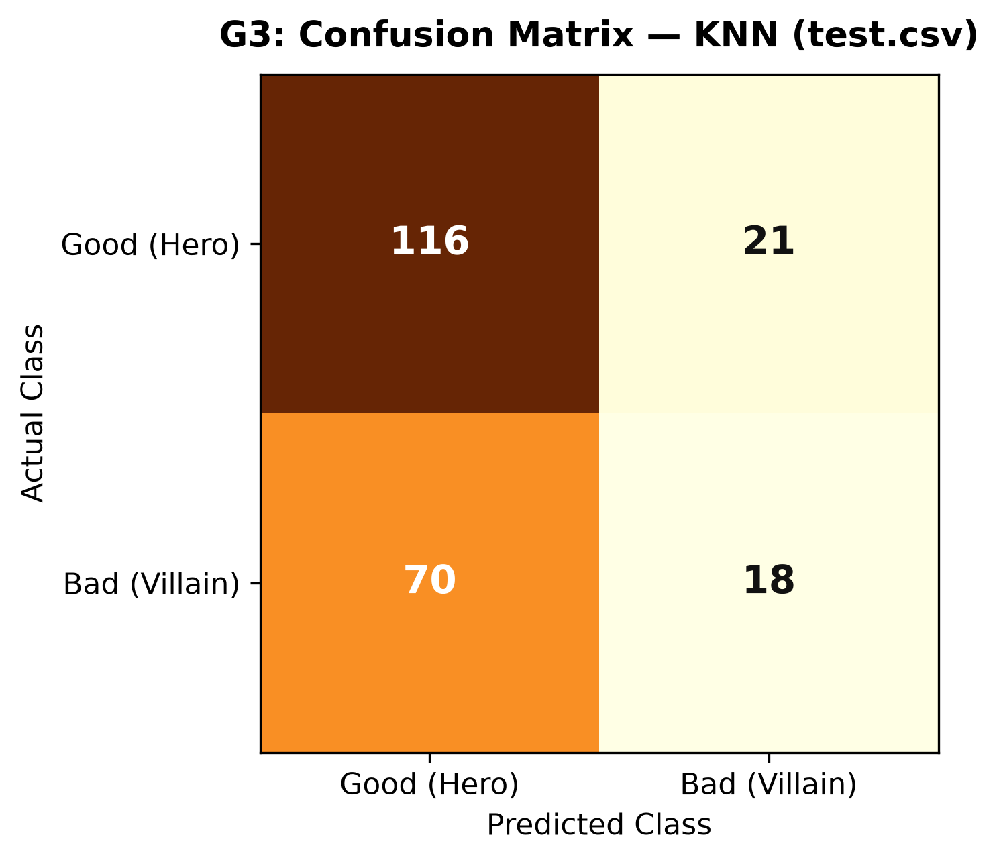

*Caption (Graph G3):* G3 shows the KNN confusion matrix on `test.csv` (116 True Heroes, 21 False Villains, 70 missed Villains, 18 True Villains). KNN captures three times as many Villains as Decision Tree (18 vs. 6, raising Villain recall from 0.068 to 0.205) with only 4 extra Hero false positives.

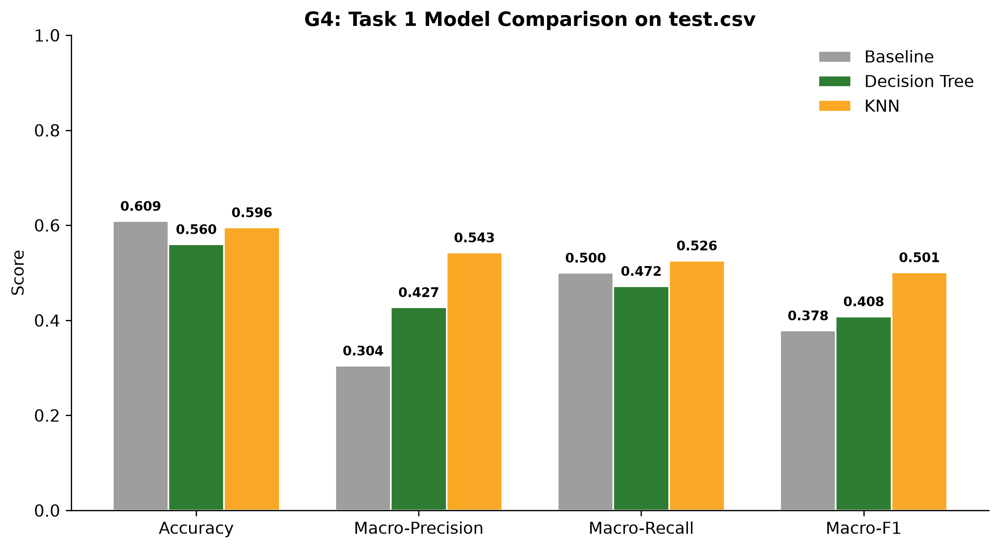

*Caption (Graph G4):* G4 compares Accuracy, Macro-Precision, Macro-Recall, and Macro-F1 across the three Task 1 models on `test.csv`. While Baseline attains the highest raw Accuracy (0.609) by predicting Hero for every character, KNN dominates every balanced metric (0.543 Macro-Precision, 0.526 Macro-Recall, 0.501 Macro-F1).

### Task 1 Report Answers (`Q1–Q4`)

- **Q1 (Which model wins by the rules? Quote the numbers.):** **KNN** wins unambiguously with the highest test Macro-F1 (**0.501**), beating Decision Tree (**0.408**) by **0.093** (exceeding the `< 0.01` tie-break threshold) and Baseline (**0.378**) by **0.123**, while also achieving the highest Villain recall (**0.205** vs. **0.068** and **0.000**).
- **Q2 (Did both models beat the Baseline? By how much?):** **Yes** on Test Macro-F1 (the primary metric): KNN beat Baseline (**0.378**) by **+0.123** (0.501), and Decision Tree beat Baseline by **+0.030** (0.408). (On raw accuracy, Baseline's 0.609 slightly exceeded KNN's 0.596 and Decision Tree's 0.560 only because Baseline predicts Hero unconditionally.)
- **Q3 (Which class is harder to predict? Use the confusion matrices.):** **Bad (Villain)** is much harder to predict. In `G2` (Decision Tree), only **6 / 88** Villains (**6.8%** recall) are identified while **82** are misclassified as Heroes (versus **120 / 137 = 87.6%** Hero recall). In `G3` (KNN), only **18 / 88** Villains (**20.5%** recall) are caught while **70** are misclassified as Heroes (versus **116 / 137 = 84.7%** Hero recall).
- **Q4 (Does either model overfit? Use the train–test gap.):** Under the `Train Macro-F1 − Test Macro-F1 > 0.10` rule, **Decision Tree clearly overfits** with a gap of **0.155** (`0.563 − 0.408 = 0.155`, unrounded `0.5628 − 0.4080 = 0.1548 > 0.10`). **KNN sits right on the 0.10 boundary**: `0.601 − 0.501 = 0.100` at 3 decimals, and `0.6011 − 0.5009 = 0.1003` unrounded—technically marginal overfitting (`> 0.10` by `0.0003`), though noticeably more stable than the Decision Tree.

---

## Section 4: Task 2 — Unsupervised Clustering (25 Marks)

### Choosing `k` & Ward Dendrogram (`G5`, `G6`, `G7`, `T6`)

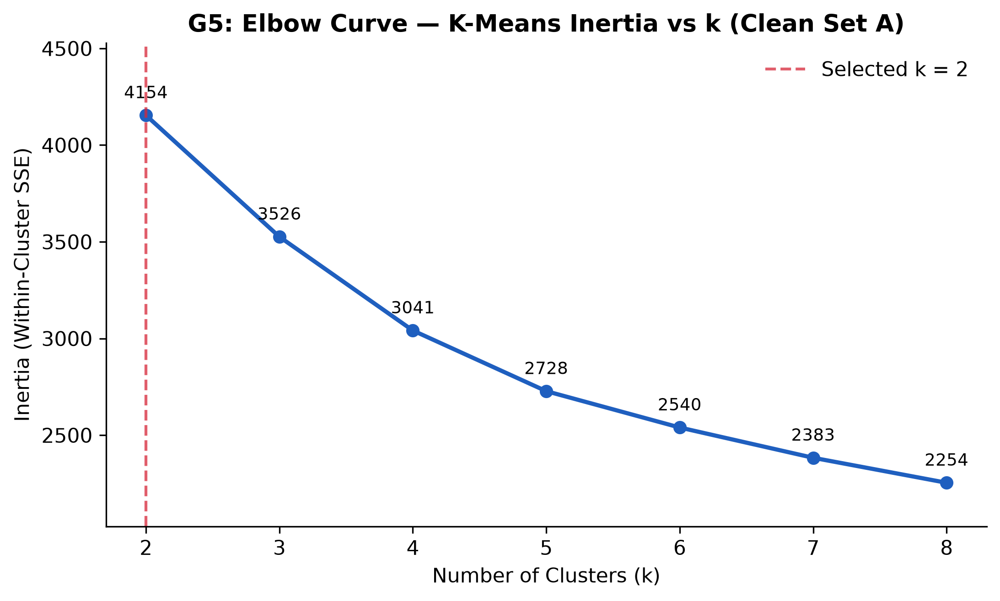

*Caption (Graph G5):* G5 plots K-Means inertia for `k = 2..8` on scaled Clean Set A (`n = 1,072`), falling steeply from 4,154 (`k = 2`) to 3,526 (`k = 3`) and 3,041 (`k = 4`) before tapering more gently through `k = 8` (2,254). Although the Elbow plot shows a mild bend around `k = 4`, the selection rule forbids letting the Elbow override Silhouette.

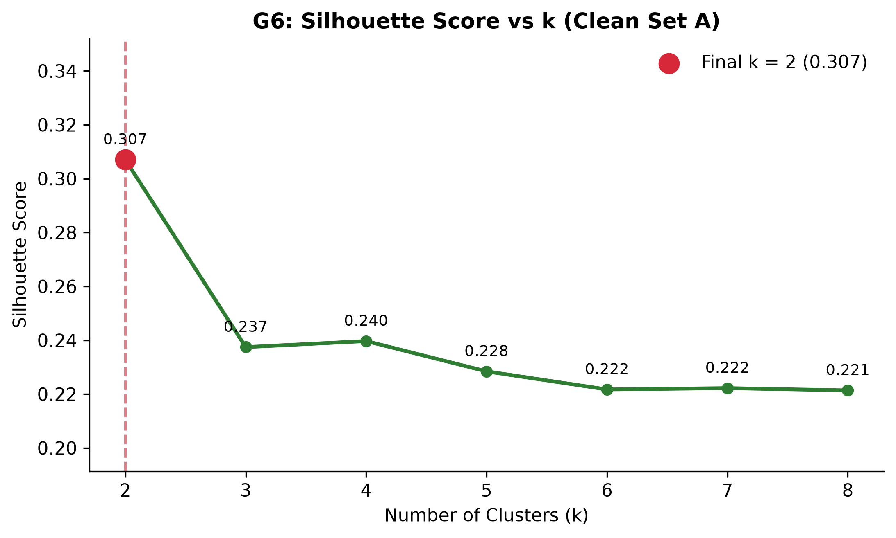

*Caption (Graph G6):* G6 shows K-Means Silhouette scores across `k = 2..8`, peaking clearly at `k = 2` (0.307) before dropping to 0.237–0.240 at `k = 3–4` and 0.221–0.228 for `k = 5–8`. Because 0.307 is the sole maximum (and falls in the 0.26–0.50 weak-structure band), `final k = 2` is selected.

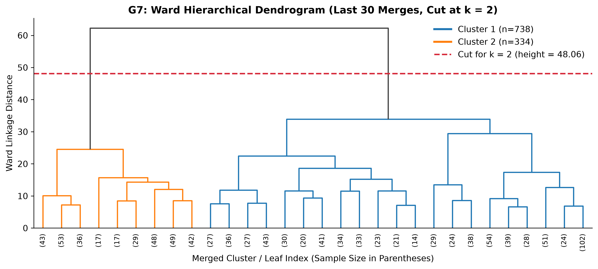

*Caption (Graph G7):* G7 displays the truncated Ward hierarchical dendrogram (last 30 merges) with a horizontal dashed cut at height 48.06, splitting the characters into Cluster 1 (blue, n = 738) and Cluster 2 (orange, n = 334) in the same tab10 colours as G9 and G11, below the final root merge at ~62.3. The large vertical distance between the two-cluster merge height (33.9) and the root merge confirms `k = 2` as the cleanest hierarchical partition.

#### Table T6: Unsupervised Clustering Metrics & ARI (Scaled Clean Set A)

| Algorithm | `k` | Silhouette ↑ | Davies–Bouldin ↓ | Calinski–Harabasz ↑ | Wins (of 3) |
|---|---:|---:|---:|---:|---:|
| K-Means | 2 | 0.3070 | 1.2740 | 586.75 | 3 |
| Agglomerative (Ward) | 2 | 0.2779 | 1.2898 | 460.92 | 0 |
| ARI between the two | 2 | ARI = 0.4834 | — | — | — |

*Caption (Table T6):* Table T6 summarizes the three internal clustering metrics and Adjusted Rand Index on scaled Clean Set A (`k = 2`), showing K-Means wins all 3 of 3 separation metrics (Silhouette 0.3070 vs. 0.2779, Davies–Bouldin 1.2740 vs. 1.2898, Calinski–Harabasz 586.75 vs. 460.92). An ARI of 0.4834 falls in the `0.40–0.69` band, indicating moderate agreement between K-Means and Ward.

---

### Shared 2D PCA Scatter & Cluster Profiles (`G8–G11`, `T7`, `T8`)

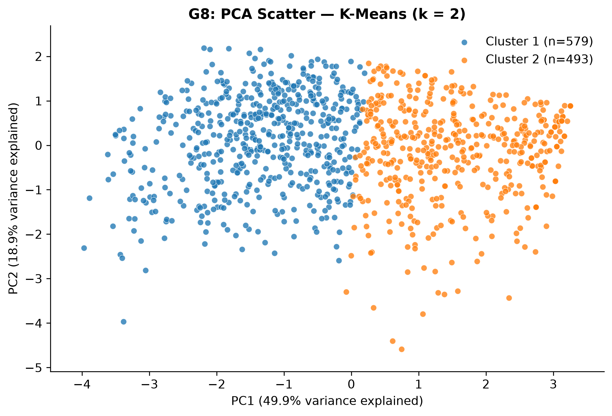

*Caption (Graph G8):* G8 projects K-Means clusters onto the first two principal components (explaining 68.8% total variance: `PC1 = 49.9%`, `PC2 = 18.9%`). K-Means creates a sharp partition near `PC1 ≈ 0`, dividing lower-scoring Cluster 1 (n = 579) from higher-scoring Cluster 2 (n = 493).

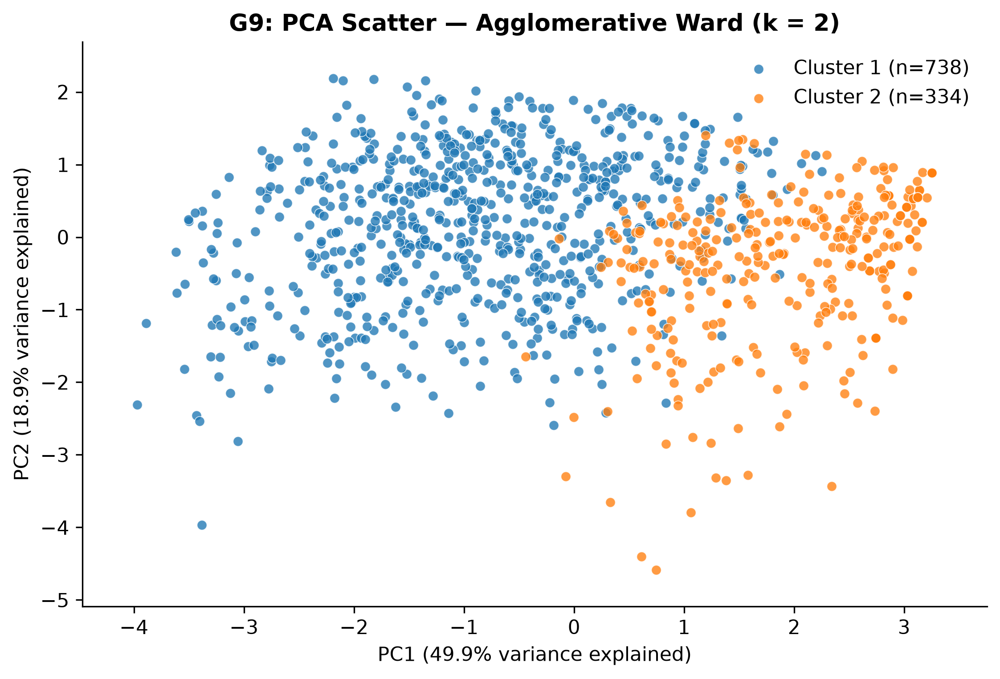

*Caption (Graph G9):* G9 projects Agglomerative Ward clusters onto the identical 2D PCA axes as G8 (`PC1 = 49.9%`, `PC2 = 18.9%`). Ward shifts the split rightward (`PC1 ≈ 0.8–1.0`), producing a larger Cluster 1 (n = 738) and a more compact, extreme-power Cluster 2 (n = 334) with mild boundary overlap in 2D PCA space.

#### Table T7a: K-Means Cluster Profiles (Original 0–100 Scale, Ascending Overall Mean)

| Cluster | Size | INT | STR | SPD | DUR | POW | COM | Name you give |
|---|---:|---:|---:|---:|---:|---:|---:|---|
| Cluster 1 | 579 | 84.5 | 20.6 | 33.1 | 40.9 | 54.0 | 67.4 | Tacticians & Street-Level Fighters |
| Cluster 2 | 493 | 86.3 | 69.5 | 71.1 | 83.5 | 93.3 | 81.6 | Cosmic & Superhuman Powerhouses |

#### Table T7b: Agglomerative (Ward) Cluster Profiles (Original 0–100 Scale, Ascending Overall Mean)

| Cluster | Size | INT | STR | SPD | DUR | POW | COM | Name you give |
|---|---:|---:|---:|---:|---:|---:|---:|---|
| Cluster 1 | 738 | 85.7 | 24.5 | 40.1 | 47.5 | 61.7 | 70.2 | Skilled Tacticians & Mid-Tier Powered |
| Cluster 2 | 334 | 84.5 | 84.3 | 73.7 | 89.1 | 95.0 | 82.1 | Apex Super-Strength Powerhouses |

*Caption (Table T7):* Tables T7a and T7b summarize mean 0–100 ability scores after renumbering clusters ascending by overall mean: in both algorithms, `Cluster 1` captures intelligent (`INT ~85`), combat-trained (`COM ~67–70`) characters with low physical Strength (`20.6–24.5`), while `Cluster 2` groups high-Strength, high-Durability, high-Power superhumans (`POW 93.3–95.0`).

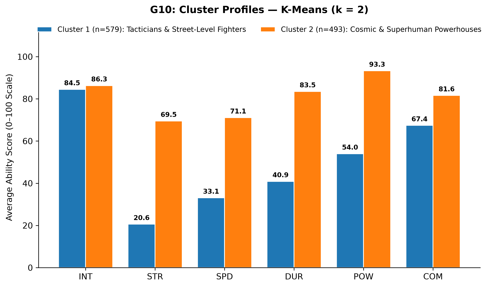

*Caption (Graph G10):* G10 plots mean 0–100 ability profiles for K-Means, showing near-identical Intelligence (`84.5` vs. `86.3`) contrasted with large gaps in Strength (`20.6` vs. `69.5`), Durability (`40.9` vs. `83.5`), Power (`54.0` vs. `93.3`), and Speed (`33.1` vs. `71.1`). Physical and energy-power scores—not intellect—separate the two groups.

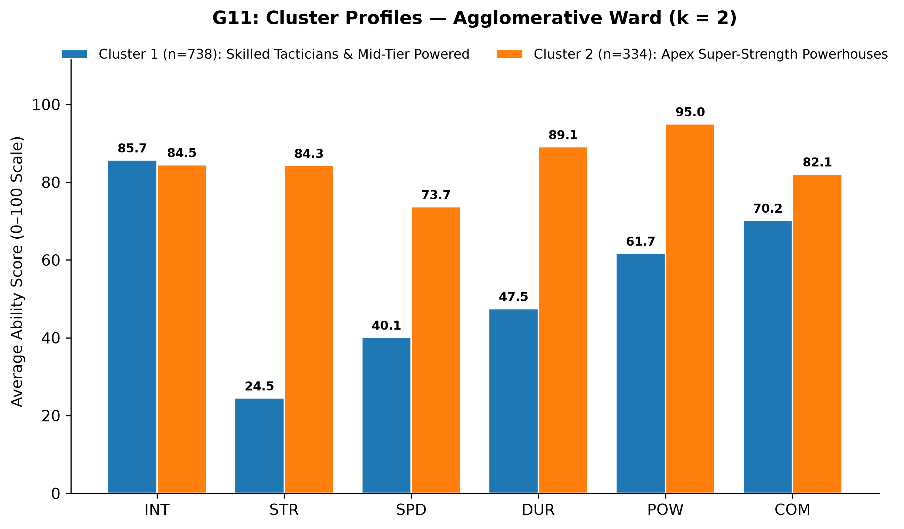

*Caption (Graph G11):* G11 plots the Agglomerative Ward cluster profiles, echoing K-Means while sharpening the Strength separation (`24.5` in Cluster 1 vs. `84.3` in Cluster 2) and raising Cluster 2 peaks in Durability (`89.1`) and Power (`95.0`). Ward isolates the heaviest physical powerhouses into Cluster 2 (n = 334) while grouping mid-tier powered heroes with street-level fighters in Cluster 1 (n = 738).

#### Table T8: Alignment Mix in Each Cluster (%) — Revealed in Step 8

| Algorithm | Cluster | Size | % Good | % Bad | % Neutral | % blank |
|---|---|---:|---:|---:|---:|---:|
| K-Means | Cluster 1 | 579 | 60.6% | 27.3% | 6.4% | 5.7% |
| K-Means | Cluster 2 | 493 | 48.1% | 34.5% | 11.4% | 6.1% |
| Agglomerative (Ward) | Cluster 1 | 738 | 59.9% | 27.4% | 6.9% | 5.8% |
| Agglomerative (Ward) | Cluster 2 | 334 | 43.7% | 37.7% | 12.6% | 6.0% |

*Caption (Table T8):* Table T8 reveals the held-aside alignment composition inside each finalized cluster: in both algorithms, Heroes form the largest share of both clusters (43.7%–60.6%), while Villains and Neutrals appear at noticeably higher rates in the powerhouse `Cluster 2` (34.5%–37.7% Bad vs. 27.3%–27.4% in `Cluster 1`). Because every cluster remains heavily mixed, ability tiers alone do not cleanly separate Heroes from Villains.

### Task 2 Report Answers (`Q5–Q8`)

- **Q5 (Which `k` did you choose? What does the Elbow say?):** We chose **`k = 2`**, which achieved the highest Silhouette Score in `k = 2..8` (**0.307**, weak structure band `0.26–0.50`, compared to 0.240 at `k = 4` and 0.237 at `k = 3`). The Elbow curve (`G5`) drops sharply from `k = 2` (4,154) to `k = 3` (3,526) and `k = 4` (3,041) before flattening more gradually for `k = 5–8`, suggesting a mild secondary elbow near `k = 4`, which does not override Silhouette under the selection rule.
- **Q6 (Did the two algorithms find similar groups? Use ARI and profiles.):** Yes, with **moderate agreement**: **ARI = 0.4834** (within the `0.40–0.69` moderate band). Both algorithms' profiles (`G10`, `G11`) identify the same core dichotomy—high-intellect/low-strength fighters (`Cluster 1`) versus high-power/high-durability powerhouses (`Cluster 2`)—differing primarily in how mid-tier characters are assigned (`n = 579/493` in K-Means vs. `n = 738/334` in Ward).
- **Q7 (Which grouping is better separated, and which is easier to interpret?):** **K-Means** is better separated because it wins **3 of 3** internal metrics (`Silhouette 0.3070 > 0.2779`, `Davies–Bouldin 1.2740 < 1.2898`, `Calinski–Harabasz 586.75 > 460.92`, satisfying `≥ 2 of 3`) and forms a cleaner boundary in PCA space (`G8`). **K-Means** is also easier to interpret: summed over the 6 scores its two cluster profiles (`G10`) differ by **184.8** points vs. **181.4** for Ward (`G11`), with wider gaps on SPD (38.0 vs. 33.6), DUR (42.6 vs. 41.6), POW (39.3 vs. 33.3) and COM (14.2 vs. 11.9). Ward separates more sharply only on Strength (`STR 84.3 vs. 24.5`, a 59.8-point gap vs. 48.9 for K-Means).
- **Q8 (Describe each cluster in plain words. Is any cluster mostly villains?):** **Cluster 1** (*Tacticians & Street-Level Fighters* in K-Means, n = 579; *Skilled Tacticians & Mid-Tier Powered* in Ward, n = 738) groups smart (`INT ~85`), skilled (`COM ~67–70`) characters with low physical Strength (`20.6–24.5`) and moderate Speed/Durability. **Cluster 2** (*Cosmic & Superhuman Powerhouses* in K-Means, n = 493; *Apex Super-Strength Powerhouses* in Ward, n = 334) groups elite all-rounders scoring high across every ability, led by Power (`93.3–95.0`) and Durability (`83.5–89.1`). **No cluster is mostly villains**—both clusters contain more Heroes than Villains (60.6% and 48.1% Good in K-Means; 59.9% and 43.7% Good in Ward), though Villains are more concentrated in `Cluster 2` (34.5%–37.7% Bad vs. 27.3%–27.4% in `Cluster 1`).

---

## Section 5: Task 3 — Neural Networks & Final 5-Model Ranking (25 Marks)

### Architectures & Locked Training Settings (`G12`, `T9`, `G13`, `G14`)

Clean Set B `train.csv` (`n = 916`) was split using `train_test_split(X, y, test_size=0.2, stratify=y, random_state=42)` into **732** training rows (80%) and **184** validation rows (20%). Both median imputation and `StandardScaler` were fit strictly on the 80% fit split.

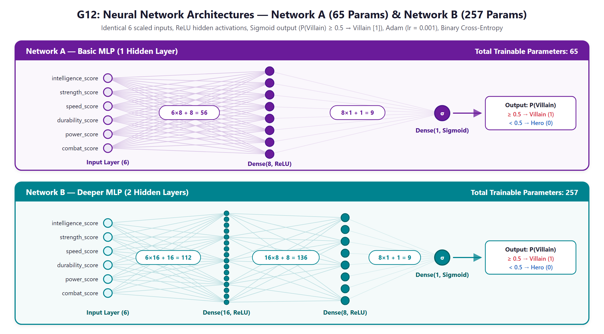

*Caption (Graph G12):* G12 diagrams Network A (`6 → 8 ReLU → 1 sigmoid`, 65 trainable parameters) and Network B (`6 → 16 ReLU → 8 ReLU → 1 sigmoid`, 257 trainable parameters). Both MLPs take the 6 standardized ability scores and output `P(Villain)` with threshold 0.5.

#### Table T9: Neural Network Settings & Best Epoch

| Network | Architecture | Trainable Params | Optimizer & LR | Loss | Batch / Max Epochs | EarlyStopping | Threshold | Epochs Run | Best Epoch | Best Val Loss |
|---|---|---:|---|---|---|---|---:|---:|---:|---:|
| Network A | `6 -> 8 (ReLU) -> 1 (Sigmoid)` | 65 | `Adam (0.001)` | `binary_crossentropy` | `32 / 200` | `val_loss, patience=15` | 0.5 | 166 | 151 | 0.6208 |
| Network B | `6 -> 16 (ReLU) -> 8 (ReLU) -> 1 (Sigmoid)` | 257 | `Adam (0.001)` | `binary_crossentropy` | `32 / 200` | `val_loss, patience=15` | 0.5 | 72 | 57 | 0.6332 |

*Caption (Table T9):* Table T9 summarizes the locked Keras training settings and EarlyStopping checkpoints, showing Network A converged to a lower best validation loss (0.6208 at epoch 151) than the deeper Network B (0.6332 at epoch 57). Network B triggered early stopping 94 epochs sooner without improving validation loss.

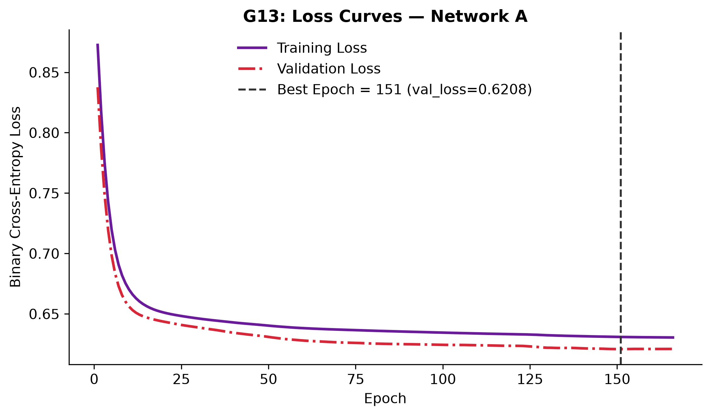

*Caption (Graph G13):* G13 plots Network A's binary cross-entropy loss across 166 epochs, showing training and validation losses declining steadily together to best `val_loss = 0.6208` at epoch 151. The parallel plateau confirms stable optimization with no overfitting.

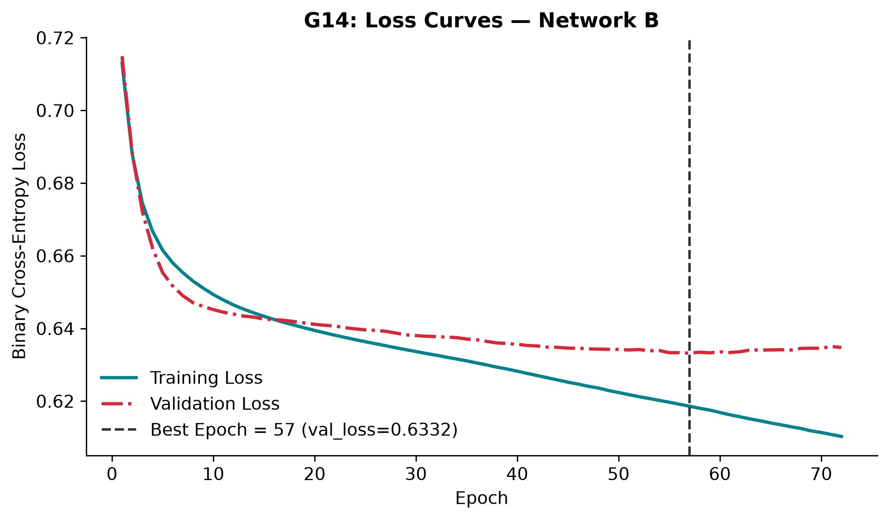

*Caption (Graph G14):* G14 plots Network B's loss across 72 epochs: validation loss falls steadily to its minimum (`val_loss = 0.6332`) at epoch 57, after which training loss keeps falling (`0.6186 → 0.6103`) while validation loss creeps upward (`0.6348` at epoch 72) until EarlyStopping halts training. This late divergence signals mild overfitting from the larger 257-parameter capacity, and `restore_best_weights=True` keeps the epoch-57 weights.

---

### Split-by-Split Evaluation & Final 5-Model Ranking (`T10`, `G15`, `T11`, `G16`)

#### Table T10a: Network A & B Results by Split

| Network | Split | Accuracy | Macro-F1 | Log loss |
|---|---|---:|---:|---:|
| Network A | Train (80%) | 0.653 | 0.494 | — |
| Network A | Validation (20%) | 0.636 | 0.460 | 0.6208 |
| Network A | Test (`test.csv`) | 0.618 | 0.455 | 0.6816 |
| Network B | Train (80%) | 0.661 | 0.485 | — |
| Network B | Validation (20%) | 0.625 | 0.422 | 0.6332 |
| Network B | Test (`test.csv`) | 0.600 | 0.421 | 0.6747 |

#### Table T10b: Per-Class Test Metrics (`test.csv`)

| Network | Precision Hero | Recall Hero | F1 Hero | Precision Villain | Recall Villain | F1 Villain |
|---|---:|---:|---:|---:|---:|---:|
| Network A | 0.621 | 0.956 | 0.753 | 0.571 | 0.091 | 0.157 |
| Network B | 0.610 | 0.949 | 0.743 | 0.417 | 0.057 | 0.100 |

*Caption (Table T10):* Table T10 presents train, validation, and test metrics alongside per-class test results, showing Network A outperforms Network B on both validation (Macro-F1 0.460 vs. 0.422) and test (Macro-F1 0.455 vs. 0.421; Accuracy 0.618 vs. 0.600). Both MLPs achieve high Hero recall (0.956 and 0.949) while predicting very few Villains (recall 0.091 and 0.057).

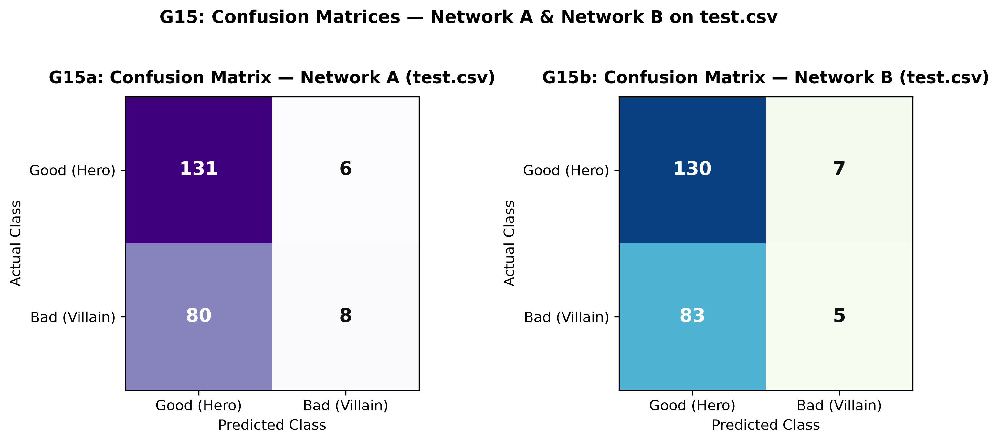

*Caption (Graph G15):* G15 shows the `test.csv` confusion matrices for Network A (131 True Heroes, 6 False Villains, 80 missed Villains, 8 True Villains) and Network B (130 True Heroes, 7 False Villains, 83 missed Villains, 5 True Villains). Both networks rarely exceed the 0.5 Villain probability threshold, missing over 90% of true Villains.

#### Table T11: Final Ranking of All 5 Models on `test.csv`

| Rank (1–5) | Model | Test accuracy | Test Macro-F1 | Villain recall | Beats baseline? |
|---:|---|---:|---:|---:|---|
| 1 | KNN | 0.596 | 0.501 | 0.205 | yes |
| 2 | Network A | 0.618 | 0.455 | 0.091 | yes |
| 3 | Network B | 0.600 | 0.421 | 0.057 | yes |
| 4 | Decision Tree | 0.560 | 0.408 | 0.068 | yes |
| 5 | Baseline | 0.609 | 0.378 | 0.000 | no |

*Caption (Table T11):* Table T11 ranks all five models on `test.csv` by Test Macro-F1: KNN places 1st (0.501 Macro-F1, 0.205 Villain recall), ahead of Network A (0.455), Network B (0.421), Decision Tree (0.408), and Baseline (0.378). Every learned model beats the Baseline on Macro-F1, with adjacent gaps all ≥ 0.013.

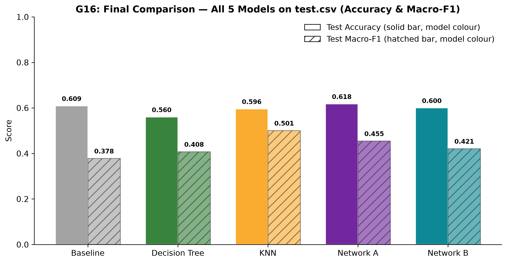

*Caption (Graph G16):* G16 compares Test Accuracy and Test Macro-F1 across all five models using their mandated fixed colours. While raw Accuracy varies narrowly between 0.560 and 0.618, Macro-F1 clearly highlights KNN (0.501) as the strongest overall Hero-vs.-Villain classifier.

### Task 3 Report Answers (`Q9–Q12`)

- **Q9 (Did Network B beat A by at least `0.01` Macro-F1? Why or why not?):** **No.** Network B scored **0.421** Test Macro-F1, which is **0.034 lower** than Network A's **0.455** (failing the `≥ +0.01` requirement, so we cannot claim the deeper network improved results). With only 732 fit examples and 6 overlapping numeric features, adding a second hidden layer (257 vs. 65 parameters) increased optimization variance and caused earlier stopping (epoch 57 vs. 151) with worse Villain recall (0.057 vs. 0.091).
- **Q10 (Do the loss curves show over- or underfitting? Which epoch was best?):** **Network A (`G13`, best epoch = 151, `val_loss = 0.6208`)** shows **no overfitting** (`Train Macro-F1 − Test Macro-F1 = 0.494 − 0.455 = 0.039 ≤ 0.10`, and both curves decline together), though its high ~0.62 loss plateau and 0.091 Villain recall indicate **underfitting / limited feature separability**. **Network B (`G14`, best epoch = 57, `val_loss = 0.6332`)** shows **mild curve-based overfitting**: although its Train–Test Macro-F1 gap is `0.485 − 0.421 = 0.064 ≤ 0.10`, training loss keeps dropping (`0.6186 → 0.6103`) while validation loss rises slightly (`0.6332 → 0.6348`) after epoch 57.
- **Q11 (Did either network beat the Decision Tree and KNN? Give numbers.):** Both networks outperformed **Decision Tree** (**0.408** Test Macro-F1): Network A scored **0.455** (`+0.047`) and Network B scored **0.421** (`+0.013`). However, **neither network beat KNN** (**0.501** Test Macro-F1, Villain recall **0.205**), trailing KNN by **0.046** (Network A) and **0.080** (Network B). *Training-data caveat:* Decision Tree and KNN trained on **100%** of Clean Set B `train.csv` (916 rows via 5-fold CV), whereas Networks A and B trained on **80%** (732 rows, holding out 184 rows for EarlyStopping validation).
- **Q12 (Name two limitations of this dataset or experiment.):**
  1. **Limited alignment signal in the 6 numeric scores alone:** Heroes and Villains overlap heavily across intelligence, strength, speed, durability, power, and combat (reflected in the weak clustering Silhouette of 0.307 and top Macro-F1 of 0.501), because moral alignment is driven by character lore and narrative rather than raw stat totals.
  2. **Class imbalance and zero-coded missing values:** Clean Set B `train.csv` contains 64.2% Heroes vs. 35.8% Villains and forbids class weights or resampling, pushing unweighted models (especially MLPs under binary cross-entropy) toward predicting Hero; additionally, 491 `0` entries in `train.csv` and 116 in `test.csv` had to be treated as missing `NaN`s (requiring median imputation and removing 86 + 20 weak rows).
